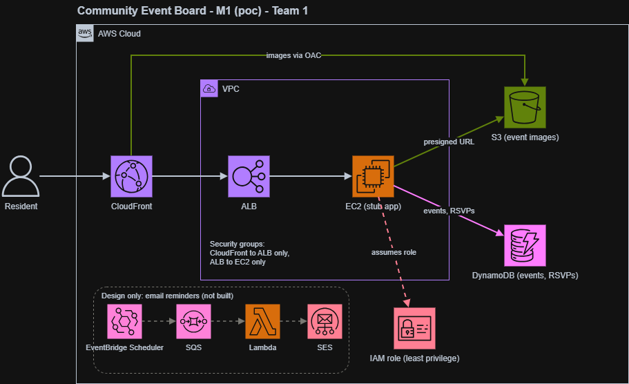
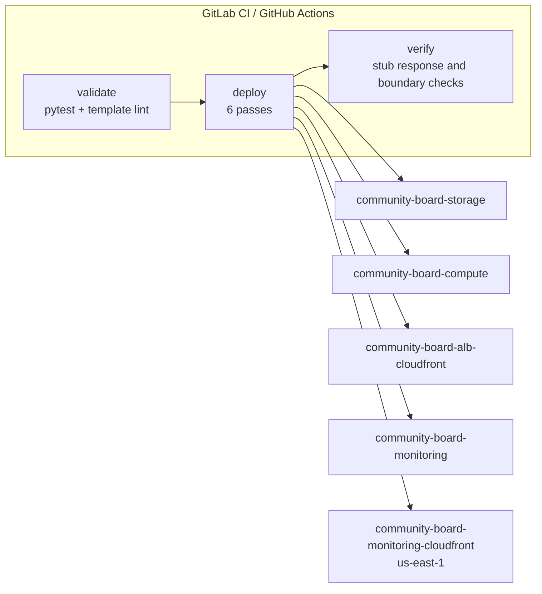

# Community Event Board — Infrastructure

[](https://github.com/7arrt/community-event-board-aws/actions/workflows/deploy.yml)

Infrastructure proof-of-concept for a community event board: a public, read-heavy,
bursty workload deployed on AWS with infrastructure as code.

> The deployed application is currently the Python stub embedded in `infra/compute.yaml`.
> Pipeline `/health` and `/events` checks prove the stub responds, not that the
> application works. A green pipeline is evidence of infrastructure, not
> application delivery.

## Author

**Sole author: Artur Tovmasyan.** Everything in this repository — the inception
document, the architecture diagram, the AWS resources (storage, compute,
delivery and monitoring), the deployment pipeline on both GitLab CI and GitHub
Actions, the offline test suite, and the cleanup procedure — was designed and
built by a single engineer.

This repository covers the infrastructure and the deployment pipeline. The real
application is not deployed by this repository state; see *Honest limitations*
below.

## Use case

A small city with bursty traffic needs a single place for event browsing and
RSVPs. These are application goals, not functionality provided by the deployed
stub.

| Goal | Repository status |
|---|---|
Event CRUD and RSVP | Requirements only; not implemented by the deployed stub |
Image upload | Goal; no presigned-URL application flow is implemented |
Email reminders | Design only; not built |
Archival | Not implemented. DynamoDB TTL is configured for `expiresAt`, but TTL deletion is not archival or export. |

## Architecture



The same topology in text, for readers without images. Editable source: `docs/event-board-architecture.drawio`.

```
Resident ──HTTPS──▶ CloudFront ──▶ ALB ──▶ EC2 (Python stub)
                      │
                      └── /images/* via OAC ──▶ private S3 bucket

DynamoDB events table is provisioned; the stub does not read or write it.
```

**Why these choices**

- **EC2 behind an ALB** — the provisioned topology for this infrastructure proof-of-concept. The instance currently serves only the embedded stub.
- **DynamoDB on-demand** — the events table is provisioned with on-demand billing; application persistence and RSVP behavior are not implemented by the stub.
- **Private S3 + CloudFront OAC** — the bucket and private read path are provisioned; no application presigning endpoint or upload flow is deployed.
- **CloudFront** — serves the configured delivery paths; `/images/*` uses `CachingOptimized` and the dynamic default behavior uses `CachingDisabled`.
- **Origin Access Control, not a public bucket** — the bucket stays private with
  Block Public Access on all four settings; only the distribution can read it.

## Deployment

Five named CloudFormation stacks are deployed on every push to `main` by either
pipeline — `.gitlab-ci.yml` or `.github/workflows/deploy.yml`.
Every resource identifier is read from stack outputs at run time — nothing is
hardcoded.



**The deploy is six ordered passes.** The bucket's CORS must name
the CloudFront distribution domain as the browser origin, and that domain does not
exist until the ALB stack has run. Storage is therefore deployed once with a
placeholder and updated afterwards with the real domain. Omitting that step leaves
the deploy looking successful while every browser request fails the CORS
preflight — a failure that passes CI and breaks only in the browser.

| # | Stack | Capability |
|---|---|---|
1 | `community-board-storage` (placeholder CORS origin) | `CAPABILITY_IAM` |
2 | `community-board-compute` (`AppRoleArn` from 1) | `CAPABILITY_IAM` |
3 | `community-board-alb-cloudfront` (IDs from 1 and 2) | none |
4 | `community-board-storage` (real CORS origin from 3) | `CAPABILITY_IAM` |
5 | `community-board-monitoring` (consumes 1 and 3) | none |
6 | `community-board-monitoring-cloudfront` (distribution id from 3; deploy only in `us-east-1`) | none |

## Continuous integration

The same infrastructure is deployable by **two pipelines that share one set of
scripts**. The deployment logic lives in `ci/`, so it exists once and the two
providers cannot drift apart.

| | GitLab CI | GitHub Actions |
|---|---|---|
| Definition | `.gitlab-ci.yml` | `.github/workflows/deploy.yml` + `cleanup.yml` |
| Stages | `preflight → validate → template-lint → deploy → verify` as pipeline stages | the same stages as jobs |
| Cleanup | manual job | manual workflow (typed confirmation required) |
| Shared scripts | `ci/deploy.sh`, `ci/verify.sh`, `ci/cleanup.sh`, `ci/egress-probe.sh` | same |

Both run on every push to `main`, and both go green only when the application is
genuinely serving:

- **validate** — the offline test suite (below), so a malformed template fails in
  seconds instead of half way through a deploy.
- **template-lint** — `aws cloudformation validate-template` on every template.
- **deploy** — the six ordered passes (above).
- **verify** — polls the target group until healthy, checks `/health` and
  `/events` return `200`, checks plain HTTP returns `301` to HTTPS, and asserts
  the negative boundary: a direct ALB request must not be answered and a direct
  S3 object URL must return `403`.

Cleanup is manual on both — it must never run on a push, or it would destroy the
environment being verified.

### Running it on GitHub Actions

The AWS jobs are opt-in, so the repository is never red for a deploy it could
not make. Configure these under **Settings → Secrets and variables → Actions**:

| Kind | Name | Value |
|---|---|---|
| Secret | `AWS_ACCESS_KEY_ID` | sandbox access key |
| Secret | `AWS_SECRET_ACCESS_KEY` | sandbox secret key |
| Secret | `AWS_SESSION_TOKEN` | sandbox session token (8-hour sandboxes expire) |
| Variable | `AWS_DEFAULT_REGION` | `eu-west-1` — optional, this is the default |
| Variable | `AWS_DEPLOY_ENABLED` | `true` to enable the AWS jobs |

Until `AWS_DEPLOY_ENABLED` is `true`, every AWS job is skipped and only the
offline `validate` job runs. Credentials are read from the environment only —
nothing is hardcoded and no keys live in the repository or in any pipeline file.
Trigger the cleanup workflow with Actions → `cleanup` → *Run workflow*, typing
`delete-all-stacks` to confirm.

The workflows pin `ubuntu-24.04` and explicit action majors rather than
`ubuntu-latest` and floating tags, so a runner migration cannot quietly change
how the deploy behaves.

## Security posture

| Control | Implementation |
|---|---|
Viewer entry | CloudFront default domain only; HTTP redirects to HTTPS |
ALB ingress | Regional CloudFront origin-facing prefix list **only** |
EC2 ingress | From the ALB security group **only**; no `/32`, no `0.0.0.0/0`, no SSH |
Images bucket | Private, Block Public Access ×4, `BucketOwnerEnforced`, SSE-S3 |
Bucket policy | `s3:GetObject` on `images/` only, scoped by `AWS:SourceArn` to one distribution |
App identity | Instance profile and role are provisioned with table and `images/` permissions; the stub does not exercise them |

The pipeline checks that a direct ALB request does not return a successful HTTP
status and that a direct S3 object URL returns `403`.

## Monitoring

`infra/monitoring.yaml` deploys four regional CloudWatch alarms and a dashboard.
`infra/monitoring-cloudfront.yaml` deploys the CloudFront alarm and dashboard in
`us-east-1`; it must never be deployed in the pipeline region.
Deliberately **metric-only, with no SNS topic**: in a throwaway sandbox an email
subscription stays unconfirmed and would page nobody while looking configured.

| Alarm | Catches |
|---|---|
`UnHealthyHostCount` | ALB cannot reach the app — the primary health signal |
`TargetResponseTime` p95 > 2s | App tier saturated |
`HTTPCode_Target_5XX_Count` | Application errors |
S3 `4xxErrors` | Image delivery breaking |

The CloudFront dashboard also charts viewer 4xx/5xx rates and cache hit rate.

## Cleanup

`ci/cleanup.sh` deletes both monitoring stacks and the remaining stacks
in reverse dependency order, using `us-east-1` for the CloudFront monitoring stack.
It empties the image bucket first, because CloudFormation cannot delete a non-empty bucket.
It is a **manual job on GitLab CI and a manual workflow on GitHub Actions** — it
must never run on a push, or it would destroy the deployed environment.

## Local setup

```powershell
git clone https://github.com/7arrt/community-event-board-aws.git
cd community-event-board-aws
pip install -r requirements-dev.txt
python -m pytest -q
```

The tests are offline — no AWS credentials needed. They parse the templates and
assert the security and ordering invariants, so a template that would break the
deploy fails in about a second instead of half way through it.

To deploy by hand, run the six ordered `aws cloudformation deploy` passes
implemented in `ci/deploy.sh`.

## Repository layout

```
infra/              CloudFormation templates (storage, compute, delivery, monitoring)
tests/              Offline test suite; no AWS credentials required
ci/                 deploy.sh, verify.sh, cleanup.sh, egress-probe.sh — shared by both pipelines
.gitlab-ci.yml      GitLab CI: preflight -> validate -> template-lint -> deploy -> verify, plus a manual cleanup job
.github/workflows/  GitHub Actions: the same pipeline as jobs, plus a manual cleanup workflow
docs/               Inception notes and the architecture diagram
screenshots/        Smoke-test evidence and the manual checklist
```

## Honest limitations

- **Application delivery is not implemented.** The deployed application is the Python stub embedded in `infra/compute.yaml`; `/health` and `/events` do not demonstrate event functionality or persistence.
- **Archival is not implemented.** DynamoDB TTL deletes expired items asynchronously; it does not archive or export them.
- **The 500-concurrent-user target is unproven.** No load test has been run. It
  remains a design target, and the latency alarm is a signal rather than a
  capacity claim.
- **Email reminders are design only**, deliberately out of scope.
- **No WAF, Shield, or rate limiting.** A deliberate poc omission, not a passed
  control.
- **Sandboxes are short-lived (8 hours).** Recorded identifiers in the docs are
  evidence of one deployment, not durable configuration. Rebuild with the
  deploy pipeline.
- **Single instance, no redundancy.** A poc trade-off: the ALB spans two AZs but
  the app tier does not.
